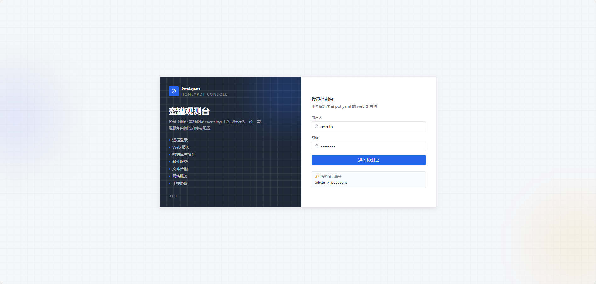
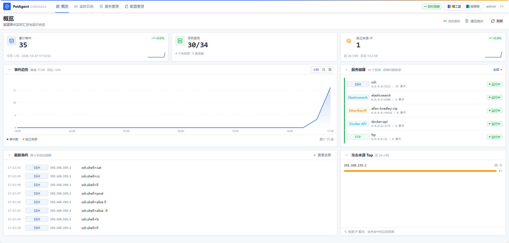
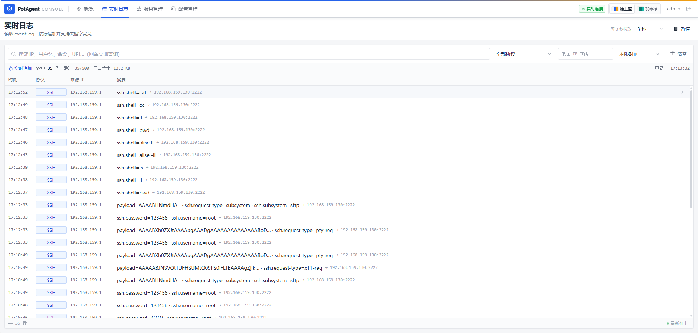
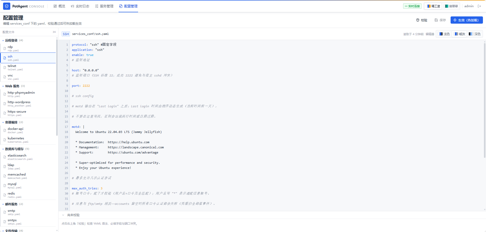

# PotAgent

PotAgent 是一个轻量级的蜜罐模拟程序，具备服务模拟、日志记录与事件统计能力，可选内置 Web 管理台。
使用 Golang 开发。PotAgent在好几年前就已经完成，现在是重写上传。
当前版本有参考 [honeytrap](https://github.com/honeytrap/honeytrap)，并按实际使用场景做了改写。

## WHY 低交互

高交互蜜罐具备极好的模拟能力，但不管是 KVM 模式还是 docker 模式创建的蜜罐系统都极其占用系统资源，扩展性也不好。
对于使用过蜜罐系统的人来说，轻量级、高仿真、可配置的低交互才是更合适的方向。
低廉的性能占用、大范围的模拟，才能更好地构成完整的感知网络。

## Feature

* **服务模拟**（每个协议一个独立 Go 包，可单独启用/停用）

  | 分类 | 协议 |
  | --- | --- |
  | 远程登录 | ssh、telnet、rdp、vnc |
  | Web 服务 | http、https |
  | 容器编排 | docker-api、kubernetes |
  | 数据库与缓存 | mysql、redis、memcached、ldap、elasticsearch |
  | 邮件服务 | smtp、smtps |
  | 文件传输 | ftp、ftps、tftp、smb |
  | 网络服务 | dns、ntp、sntp、snmp、sip |
  | 工控协议 | modbus-tcp、s7、cip、fins、mitsubishi a1e/qna3e、bacnet、mqtt（含 mqtts） |

  待支持：rtsp、postgresql、mongodb

* **多服务配置启动**：通过 `services_conf/*.yaml` 配置多个不同端口、不同应用的服务实例，互不影响。
* **日志输出**：事件以 JSON 行写入 `event.log`，同时支持推送到 kafka；字段按协议展开（用户名、口令、命令、URI、请求体等）。
* **Web 管理台**（可选，编进主进程）：日志检索与详情、服务启停与热加载、配置在线编辑与校验、事件统计与趋势、一键清空统计。
* **配置热加载**：改 yaml 后点"生效"，只重启变更的实例，其它监听不中断。
* **交互式命令模拟**：SSH / Telnet 内置 `whoami` / `id` / `uname` / `pwd` / `cd` / `ls` / `cat` / `echo` / `date` / `uptime` / `history` 等常用命令，输出内容与系统版本可在 yaml 中伪造。
* **大模型接入**（规划中）：AI 生成更真实的模拟响应，提高仿真度。
  - [ ] DeepSeek
  - [ ] QWEN

## 两种运行方式

管理与不管理是**同一个二进制**：前端构建产物已嵌入 `PotAgent`，不需要单独部署 Web 服务。
差异只在 `pot.yaml` 的 `web.enable`：

| | 方式一：带 Web 管理台（默认） | 方式二：纯蜜罐（无 Web） |
| --- | --- | --- |
| 配置 | `web.enable: true` | `web.enable: false` |
| 额外监听 | `0.0.0.0:58090`（可改 `web.port`） | 无 |
| 查看日志 | 页面检索/筛选/详情，也可直接看 `event.log` | 直接看 `event.log` / kafka |
| 服务启停 | 页面开关、单实例重启、全量热加载 | 改 yaml 后重启进程 |
| 事件统计 | 概览、趋势、来源 Top、服务事件数（SQLite 小时桶） | 无（不写统计库） |
| 配置修改 | 页面在线编辑 + 语法校验 | 直接编辑 yaml |
| 适用场景 | 需要人工观测/调参的节点 | 大规模部署、只做采集转发的节点 |

两种方式共用同一套 `services_conf`、`event.log` 格式与 `--protocol` 过滤参数，可以在部署时按节点角色选择。

## 界面截图

登录页（会话 Cookie + 同一来源登录失败限速）：



概览（累计事件 / 活跃服务 / 独立来源、事件趋势、服务健康按事件数排序、最新事件、攻击来源 Top）：



实时日志（最新在最上、摘要由 `details` 字段摊平，支持关键字 / 协议 / 来源 IP / 时间范围过滤）：



配置管理（左侧按协议分类分组，右侧在线编辑 yaml，保存后可校验并一键热加载）：



## 编译与运行

```bash
# 1) 安装前端依赖（首次或 package.json 变更后）
make web-deps

# 2) 构建前端（产物复制到 web/server/dist）
make web

# 3) 编译二进制：debug 带调用位置，release 为生产构建
make debug        # 或 make release
```

也可以直接用 go 构建（前端未构建时页面会提示"前端未构建"，API 仍然可用）：

```bash
go build -o PotAgent ./cmd/potagent
```

运行：

```bash
./PotAgent                      # 读当前目录的 pot.yaml
./PotAgent -c /etc/potagent/pot.yaml
./PotAgent -p ssh,mysql         # 只启动指定协议
```

* 前端开发态热更新：`make web-dev`（Vite dev server 5173，`/api` 代理到 `127.0.0.1:58090`）。
* 同一份配置**只允许一个进程**运行（`potagent.lock` 排他锁）；重复启动会直接报错退出。
* `web.enable: true` 时会先占住管理台端口，端口被占用则立即退出，不会先拉起一堆蜜罐实例。

## 配置文件（pot.yaml）

```yaml
services_dir: "./services_conf"   # 服务实例 yaml 目录
log_level: "info"                 # debug / info / warn / error（debug 会打印调用位置）

outputs:
  file:
    enable: true
    file_path: "event.log"        # 事件 JSON 行
  kafka:
    enable: false
    host: "127.0.0.1"
    port: 9092
    topic: "test"

web:
  enable: true                    # 关掉即为"纯蜜罐"方式运行
  host: "0.0.0.0"                 # 改 127.0.0.1 则仅本机可访问
  port: 58090                     # 高位端口，避免与常见服务冲突
  username: "admin"
  password: "potagent"            # 支持明文，或 bcrypt:<hash>
  stats_db_path: "./potagent_stats.db"
  session_ttl_minutes: 480
```

生成 bcrypt 口令：`htpasswd -bnBC 10 "" '你的口令' | tr -d ':\n'`，结果前加 `bcrypt:` 写入 `password`。

## 文件目录

```
├─ cmd/potagent/        # 程序入口（urfave/cli）
├─ services/            # 各协议实现，每个协议一个包，init 时 services.Register
│  └─ cmdsim/           # SSH/Telnet 共用的内置命令模拟
├─ manager/             # 实例生命周期：启动、差异热加载、端口预检、就绪确认
├─ web/
│  ├─ server/           # 管理台后端（HTTP + SQLite 统计，编进主进程）
│  └─ frontend/         # Vue 3 + TS 前端源码，构建产物嵌入二进制
├─ docs/                # 文档与截图
├─ services_conf/       # 各服务实例配置
│  ├─ *.yaml            # 每个文件 = 一个实例
│  ├─ https/            # 自签证书 cert.pem / key.pem（测试用）
│  └─ assets/           # 各协议静态资源，启动时由 assets.zip 解压
├─ pot.yaml             # 程序配置
├─ event.log            # 事件输出（运行时生成）
├─ potagent_stats.db    # 统计库（运行时生成）
└─ potagent.lock        # 单实例锁（运行时生成，内容为 pid）
```

## 文档

* [新增 / 删除服务时的改动清单](docs/adding-service.md)：新增协议要改哪些前端文件、`MarkReady()` 的坑、验证清单。
* [开发路线](docs/roadmap.md)
* [管理台说明](web/README.md)：路由、鉴权、热加载与统计口径。

## 其他

* 如需正式环境证书，替换 `cert_file` / `key_file` 指向的 CA 签发文件，建议不要把私钥提交进仓库。
* 暴露到网络前务必修改管理台默认口令，并按需把 `web.host` 收敛到具体网卡。
